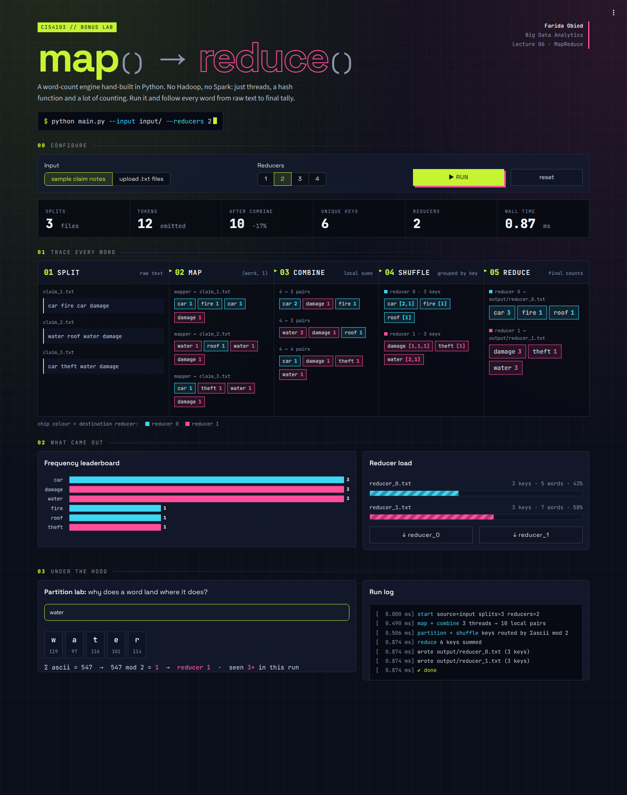

# map() → reduce() · Mini MapReduce Engine

A word-count MapReduce engine built from scratch in plain Python. It doesn't use Hadoop or Spark. You can run it from the command line, or use a dark, neon Streamlit dashboard that shows how every word moves through the pipeline.

| | |
|---|---|
| **Student** | Farida Obied |
| **Student ID** | 231004096 |
| **Course** | CIS4103 · Big Data Analytics, Lecture 06 |
| **Assignment** | Bonus: Build Your MapReduce (5 marks) |



---

## Quick start

```bash
pip install -r requirements.txt

python main.py          # command-line run on input/
streamlit run app.py    # interactive dashboard at http://localhost:8501
```

Requires Python 3.9 or newer.

---

## How it works

Every phase is a plain Python function in [`engine.py`](engine.py):

```
input/*.txt   one file = one split
   │
   ├─ 01 MAP        split each line into words, lowercase them, strip punctuation
   ├─ 02 COMBINE    each mapper adds up its own word counts before sending them on
   ├─ 03 PARTITION  reducer = sum(ord(c) for c in word) % num_reducers
   ├─ 04 SHUFFLE    group counts by word across all mappers, sort each reducer's words
   └─ 05 REDUCE     add up the counts and write output/reducer_<id>.txt
```

| Phase | Function | What it does |
|---|---|---|
| Map + Combine | `map_fn()` | Reads one split and returns `(word, local_count)` pairs |
| Parallelism | `run_mappers()` | Starts one thread per split |
| Partition | `partition()` | Picks a reducer from the sum of the word's ASCII codes |
| Shuffle & Sort | `shuffle_and_sort()` | Groups counts by word, one sorted bucket per reducer |
| Reduce | `reduce_fn()` | Adds up the counts and writes the reducer's output file |
| Orchestrator | `run()` | Runs every phase in order and returns the results to the CLI and the dashboard |

**Design choices**

- **Combiner in the mapper.** Each mapper adds up its own counts before the shuffle. It sends `("car", 2)` instead of `("car", 1)` twice, so less data moves between phases.
- **Deterministic partitioning.** The same word always goes to the same reducer on every run, so each word's final count is computed in exactly one place.
- **Independent mappers.** Each split gets its own thread, and the mappers don't share any data. Their results only meet in the shuffle phase, as in a real cluster.

---

## Command line

```bash
python main.py --input input/ --output output/ --reducers 2
```

| Flag | Default | Meaning |
|---|---|---|
| `--input` | `input` | Folder of `.txt` splits |
| `--output` | `output` | Where the `reducer_<id>.txt` files are written |
| `--reducers` | `2` | Number of reducers |

---

## Dashboard

`streamlit run app.py` opens a dark, terminal-style dashboard with these sections:

- **Configure:** use the sample claim notes or upload your own `.txt` files, and pick 1 to 4 reducers.
- **Ticker:** splits, tokens emitted, pairs left after combining, unique keys, and total run time.
- **Trace board:** five columns (Split → Map → Combine → Shuffle → Reduce) showing your actual words. Each word is coloured by the reducer it is sent to, so you can follow it from the raw text to its final count.
- **What came out:** a word-frequency chart, how many words each reducer got, and a download button for each reducer's output.
- **Partition lab:** type any word to see its ASCII codes, their sum, and the `mod` that picks its reducer.
- **Run log:** the real time each phase took, in milliseconds.

---

## Example

**Input** (three ETI insurance claim notes)

```
input/claim_1.txt   car fire car damage
input/claim_2.txt   water roof water damage
input/claim_3.txt   car theft water damage
```

**Output** with 2 reducers

| `output/reducer_0.txt` | | `output/reducer_1.txt` | |
|---|---|---|---|
| car | 3 | damage | 3 |
| fire | 1 | theft | 1 |
| roof | 1 | water | 3 |

**Check:** 3 + 1 + 1 + 3 + 1 + 3 = **12**, the same as the 12 words in the input.

**Why does `water` go to reducer 1?**
`w(119) + a(97) + t(116) + e(101) + r(114) = 547`, and `547 mod 2 = 1`.

---

## Project structure

```
.
├── engine.py            MapReduce phases
├── main.py              command-line interface
├── app.py               Streamlit dashboard
├── requirements.txt     streamlit, pandas, altair
├── .streamlit/
│   └── config.toml      dark theme
├── input/               sample splits (claim_1–3.txt)
├── docs/
│   └── screenshot.png
├── datasets/            course-provided text corpora
└── output/              created at runtime (git-ignored)
```

---

## Course Instructions

1. Fork this repository to your GitHub account.
2. Complete each programming task in its own folder in your fork, and push your work there.
3. Add your name and student ID to this README in your fork.
